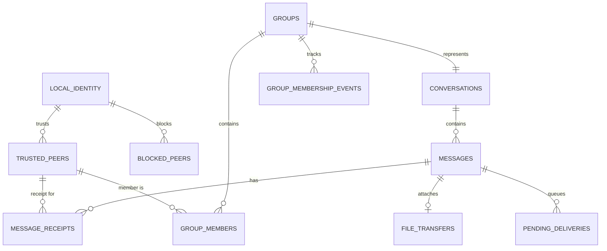

# Roomie — Identity, Pairing & Network Protocol Specification


Architecture decisions finalized

Pre-implementation specification


We're now moving from the high-level architecture into the actual engineering design.

Your two decisions establish the foundation:

- Identity: Username + automatically generated device identity.
- Network scope: Same local subnet only.
- Communication: Direct peer-to-peer.
- Platform: Windows only.
- Authentication: Trusted device pairing.
- Persistence: Each computer maintains its own local identity and chat database.

One important design decision: a username is a display identity, not a security credential. The device identity is what establishes trust.

For example, two computers may both have the username `Subhashish`, but they must have different device identities.

# 1. Identity architecture

## 1.1 Two levels of identity

Every installation gets two identifiers.

LEVEL 1 — HUMAN-READABLE IDENTITY

# Subhashish

Display name / username

Used in contact lists, chat headers, group conversations, and notifications.

LEVEL 2 — CRYPTOGRAPHIC DEVICE IDENTITY

## RM-7F92-A31C-8D20

Example display representation of a stable device identifier

Used for device recognition, authentication, trusted peer records, and connection verification.

### Device identity generation

On first application launch:

1. Generate a cryptographically secure random device identifier.
2. Generate an asymmetric cryptographic key pair.
3. Create a self-signed device certificate containing the public key.
4. Persist the identity and private key securely.
5. Never regenerate the identity on ordinary application restarts.

Recommended implementation:

| Component             | Technology                                              |
| --------------------- | ------------------------------------------------------- |
| Device ID             | Cryptographically secure random UUID                    |
| Key algorithm         | ECDSA P-256                                             |
| Certificate           | X.509                                                   |
| Certificate signature | SHA-256                                                 |
| Private key storage   | Windows DPAPI                                           |
| Certificate storage   | Windows certificate store or protected application data |

The private key must never be transmitted to another computer.

Use the certificate's public key fingerprint as the trust anchor. The random device ID is a convenient identifier, not proof of identity.

### Device identity lifecycle

| Event                           | Behavior                                                    |
| ------------------------------- | ----------------------------------------------------------- |
| Restart application             | Reuse identity                                              |
| Change username                 | Preserve device ID                                          |
| Change IP address               | Preserve device ID                                          |
| Reinstall without deleting data | Reuse identity if identity data survives                    |
| Delete application identity     | Generate new identity                                       |
| Copy installation to another PC | Detect duplicate identity and require identity regeneration |

**How duplicate identities are detected.** The private key is encrypted with DPAPI using `DataProtectionScope.CurrentUser`. DPAPI ciphertext can only be decrypted by the same Windows user on the same machine, so a copied `identity/` folder fails to decrypt on any other PC or account. On startup:

1. Try to decrypt the private key.
2. If decryption fails with a cryptographic error, treat the identity as foreign: move the old identity folder to `identity/orphaned-<timestamp>/`, generate a new identity, and tell the user that previously paired devices will show an identity-change warning and must re-pair.
3. Never fall back to generating a new identity silently when the failure is something else (file locked, I/O error); surface the error instead.

As a second check, peers that see the same `deviceId` announced with two different certificate fingerprints raise an identity conflict for that device instead of trusting either.

Important: Don't use Windows computer names, MAC addresses, or IP addresses as permanent device IDs. They can change and are not reliable security credentials.

## 1.2 Local identity data model

The local database should contain a `LocalIdentity` record.

```
{
  "deviceId": "7f92a31c-8d20-4b71-a6e3-...",
  "username": "Subhashish",
  "certificateFingerprint": "SHA256:...",
  "publicKey": "...",
  "createdAt": "2026-10-30T12:00:00Z",
  "identityVersion": 1
}
```

This is a conceptual representation. The private key is deliberately excluded.

The username is editable. The device ID and cryptographic identity are stable.

### Trusted peer record

Every computer stores information about devices it has explicitly trusted.

```
{
  "peerId": "a82f21c0-...",
  "username": "Office PC",
  "certificateFingerprint": "SHA256:...",
  "publicKey": "...",
  "trustedAt": "2026-10-30T12:30:00Z",
  "trustStatus": "trusted",
  "lastKnownIp": "192.168.1.105",
  "lastSeenAt": "2026-10-30T12:35:00Z"
}
```

The IP address is only a connection hint. It is never the peer's identity.

### Identity rules

1. Multiple devices may share a username.
2. A device ID must be unique.
3. A device cannot silently replace its cryptographic identity.
4. Changing a username must not break existing conversations.
5. Removing a trusted peer must revoke local trust.
6. A changed certificate fingerprint must trigger an identity-change warning, never silent acceptance.

# 2. Peer discovery architecture

The application should distinguish between three things:

- Discovered: A computer has announced itself.
- Connected: A network connection is active.
- Trusted: The user has approved its cryptographic identity.

These states must not be mixed.

A newly discovered computer is not automatically a trusted contact.

## 2.1 Discovery configuration

| Setting               | Specification                 |
| --------------------- | ----------------------------- |
| Protocol              | UDP                           |
| Port                  | 45820                         |
| Address               | IPv4 subnet broadcast         |
| Announcement interval | 5 seconds                     |
| Discovery request     | Broadcast once at startup and on network change |
| Response              | Unicast `DISCOVERY_RESPONSE` to a `DISCOVERY_REQUEST`, after 0–500 ms random delay |
| Offline timeout       | 20 seconds                    |
| Peer identification   | Device UUID                   |
| Network scope         | Active private LAN interfaces |

The application should bind to each eligible network interface separately rather than assuming one Wi-Fi adapter or one IP address.

### Discovery packet

```
{
  "protocol": "roomie",
  "protocolVersion": 1,
  "type": "DISCOVERY_ANNOUNCE",
  "deviceId": "7f92a31c-...",
  "username": "Subhashish",
  "tcpPort": 45821,
  "appVersion": "1.0.0"
}
```

Three discovery packet types share this shape:

| Type                 | Sent                                           | Destination |
| -------------------- | ---------------------------------------------- | ----------- |
| `DISCOVERY_ANNOUNCE` | Every 5 seconds                                | Broadcast   |
| `DISCOVERY_REQUEST`  | At startup and when a network interface changes, so a new peer doesn't wait up to 5 seconds | Broadcast   |
| `DISCOVERY_RESPONSE` | In reply to a `DISCOVERY_REQUEST`              | Unicast to the requester |

Each peer sends at most one `DISCOVERY_RESPONSE` per requester every 2 seconds. A peer ignores its own packets, identified by its `deviceId`.

Discovery packets should remain small (maximum 1 KB), contain no private information, and never contain authentication secrets.

The receiver should validate:

- Protocol name and version.
- Device ID format.
- Username length.
- TCP port range.
- Packet size.
- Source interface and subnet.

Ignore malformed packets and rate-limit discovery responses.

## 2.2 Discovery sequence

## Peer discovery flow

PC A starts

Discovery listener initialized

UDP announcement

Broadcast on active LAN interfaces

PC B receives announcement

Validate packet and inspect device ID

Peer appears in discovery list

Untrusted / discovered state

Secure connection and pairing

Only after authentication does it become trusted

### Handling duplicate announcements

Suppose PC A has Wi-Fi and Ethernet enabled. It might receive announcements from the same peer through multiple interfaces.

Use `deviceId` as the unique key.

Maintain a peer registry:

```
PeerRegistry
    ├── Device ID
    ├── Username
    ├── IP addresses
    ├── TCP port
    ├── Last announcement
    ├── Connection state
    └── Trust state
```

Do not create a new contact every time a packet arrives.

# 3. Peer pairing flow

This is the most important security interaction.

I recommend mutual trust with a six-digit verification code, backed by cryptographic key verification.

Neither side should automatically trust the other simply because the other side initiated a connection.

## 3.1 First-time pairing

Imagine Alice wants to connect to Bob.

## First-time pairing

1. Alice discovers Bob

   Bob appears in Alice's available devices list as `Not paired`.
2. Alice selects Connect

   Alice initiates a TCP connection to Bob. A user-initiated connect is always allowed, whichever device ID is smaller. The ownership rule in §4.2 only resolves duplicates and decides who redials automatically.
3. Secure handshake

   Both devices exchange and validate their cryptographic identities using TLS and the pairing protocol.
4. Verification code generated

   Both devices independently calculate the same six-digit short authentication string from the authenticated handshake transcript.
5. Users compare the codes

   Alice and Bob confirm that the codes shown on both screens match.
6. Both approve

   Each device explicitly accepts the pairing.
7. Trust saved

   Each device saves the other's certificate fingerprint and device ID.
8. Connection becomes trusted

   The peer can now exchange messages and files according to the application's permissions.

### Verification screen concept

Alice's PC

# 482 193

Verify with Bob

Bob's PC

# 482 193

Verify with Alice

Illustrative matching codes, not generated by a live connection.

### How to generate the verification code securely

Do not use a random six-digit number generated independently by each computer.

On first contact neither side has a pinned certificate, so an active attacker can terminate TLS on both sides with certificates of their own. The short code is what exposes that attacker, and it only works if neither party, including an attacker sitting between them, can choose its key material *after* seeing the other side's. Otherwise the attacker can try ephemeral keys offline until both codes collide; a 6-digit code is only about 2²⁰ attempts. The handshake therefore uses **commit-then-reveal**, as in ZRTP and Bluetooth Secure Simple Pairing.

Preconditions: the TLS session is **mutually authenticated**. The listener requires a client certificate, and both sides present their device certificate (see §10).

Let `A` be the TLS client (initiator) and `B` the TLS server (responder). `certA`/`certB` are the DER-encoded device certificates seen in the TLS handshake.

1. **Commit.** A generates an ephemeral ECDH P-256 key pair `eA` and a 32-byte random nonce `nA`. A sends `PAIR_REQUEST` containing `commitA = SHA-256("RMP-PAIR-COMMIT" ‖ pub(eA) ‖ nA)`. A's key itself is not sent yet.
2. **Responder reveals.** B generates `eB` and nonce `nB`. B sends `PAIR_RESPONSE` containing `pub(eB)`, `nB`, and `sigB = Sign_B(transcript)`.
3. **Initiator reveals.** A sends `PAIR_REVEAL` containing `pub(eA)`, `nA`, and `sigA = Sign_A(transcript)`.
4. **Verify.** B checks that `SHA-256("RMP-PAIR-COMMIT" ‖ pub(eA) ‖ nA) == commitA`, and aborts on mismatch. Each side verifies the other's signature with the public key from the certificate presented in TLS.
5. **Derive.** Both compute `Z = ECDH(eA, pub(eB))`, then
   `sas = HKDF-SHA256(ikm = Z, salt = nA ‖ nB, info = "RMP-PAIR-SAS-v1" ‖ transcript, length = 4)`.
   The six-digit code is `uint32_be(sas) mod 1_000_000`, zero-padded and shown as `482 193`.
6. **Compare and approve.** Users compare the codes, and each side sends `PAIR_APPROVE` or `PAIR_REJECT`.

`transcript = "RMP-PAIR-v1" ‖ fp(certA) ‖ fp(certB) ‖ deviceIdA ‖ deviceIdB ‖ commitA ‖ pub(eB) ‖ nB`. Each field is length-prefixed. `fp` is the SHA-256 of the certificate's SubjectPublicKeyInfo. A signs the transcript extended with `pub(eA) ‖ nA`.

Why this holds: B reveals `eB` before seeing `eA`, and A is bound to `eA` before seeing `eB`. An attacker relaying between them must fix both values before learning the other, so each pairing attempt succeeds with probability about 1 in 10⁶. The code is bound to both certificates and device IDs, so a successful compare also confirms that each side is talking to the certificate it will pin.

The ephemeral keys and `Z` are used only to derive the code. They are discarded afterwards and never used for message encryption, which TLS already provides.

Both sides must approve. A one-sided approval must not establish a trusted relationship.

For stronger assurance, also offer full fingerprint verification in an advanced details view. Six-digit codes have limited entropy, so rate-limit failed pairing attempts and require a new session after repeated failures.

#### Wire encodings (as implemented)

"A" is the device that sends `PAIR_REQUEST`, whichever side opened the TLS connection. The transcript names both certificates by role, so the TLS direction doesn't matter.

| Value | Encoding |
| ----- | -------- |
| `pub(e)` | 91-byte DER SubjectPublicKeyInfo of a P-256 key; any other curve or length is rejected |
| `n` | 32 random bytes |
| `fp(cert)` | 32-byte SHA-256 of the certificate's SubjectPublicKeyInfo (the raw bytes of the `SHA256:` fingerprint) |
| `deviceId` | 16 bytes, RFC 4122 big-endian order |
| length prefix | 32-bit big-endian byte count before every transcript field, including the `RMP-PAIR-v1` label and the two fields A appends before signing |
| signatures | ECDSA P-256 / SHA-256 with the device key, IEEE P1363 (64 bytes), verified with the key from the certificate presented in TLS |

`commitA` hashes its three parts without length prefixes: they have fixed lengths.

Payloads, with binary fields in base64:

| Message | Payload |
| ------- | ------- |
| `PAIR_REQUEST` | `pairingId`, `commitment` (32 bytes) |
| `PAIR_RESPONSE`, `PAIR_REVEAL` | `pairingId`, `ephemeralKey` (91), `nonce` (32), `signature` (64) |
| `PAIR_APPROVE` | `pairingId` |
| `PAIR_REJECT` | `pairingId`, `reason`: `DECLINED`, `CANCELLED`, `BUSY`, `TIMEOUT`, `VERIFICATION_FAILED` or `TOO_MANY_ATTEMPTS` |

Rules:
- One attempt runs at a time. A request arriving during another attempt gets `BUSY`.
- If both users press Pair at once, the request from the smaller device ID goes ahead and the other side silently drops its own.
- An attempt fails after 2 minutes.
- Every non-success except `BUSY` and a plain cancel counts as a failure. After 5 failures with one device in 10 minutes, new attempts are refused. After 3 failures on one session, the session is closed.
- Only after both `PAIR_APPROVE`s does each side pin the other's fingerprint and upgrade the live session to trusted.
- Removing or blocking a device ends its session immediately.

## 3.2 Subsequent connections

Once two devices are paired:

- Discover each other.
- Establish a new TCP connection.
- Authenticate the remote certificate against the saved fingerprint.
- Verify the expected device ID.
- Establish the encrypted session.
- Resume pending deliveries.

No repeated manual pairing should be necessary unless trust has been revoked or the identity has changed.

## 3.3 Pairing states

| State             | Meaning                              |
| ----------------- | ------------------------------------ |
| Discovered        | Found through UDP                    |
| Connecting        | TCP connection initiated             |
| Verifying         | Identity and handshake being checked |
| Awaiting approval | User confirmation required           |
| Trusted           | Both sides approved and saved trust  |
| Rejected          | Pairing declined                     |
| Blocked           | User explicitly blocked peer         |
| Identity changed  | Saved identity no longer matches     |

A blocked peer must not be allowed to initiate a new pairing silently.

# 4. Connection lifecycle

The application needs a well-defined connection state machine.

Without this, you'll eventually get duplicate connections, ghost online users, and messages being sent over dead sockets.

## 4.1 Connection states

## Connection state machine

Disconnected

Discovered

Connecting

Authenticating

Pairing / Trust verification

Connected — Trusted

Active communication

Closing / Reconnecting

Disconnected

Rejected, blocked, and identity-mismatch conditions branch into separate failure states.

## 4.2 Connection manager responsibilities

Create one dedicated `ConnectionManager` service.

It should handle:

- Starting and stopping TCP listeners.
- Establishing outbound connections.
- Maintaining active peer sessions.
- Detecting duplicate connections.
- Reconnecting after network interruptions.
- Sending heartbeats.
- Cleaning up disconnected sessions.
- Publishing connection-state changes to the UI.

### Avoid duplicate TCP sessions

Both Alice and Bob may independently attempt to connect to each other.

For V1, establish a deterministic connection ownership rule based on the device IDs. Compare the canonical lowercase UUID strings ordinally.

- **Automatic reconnection** of a trusted peer is started by the side with the smaller ID. The larger side does not dial automatically unless no session exists 10 seconds after it sees the peer's announcement, which covers a firewall blocking one direction.
- **User-initiated connections** (Connect, first-time pairing) may come from either side.
- **Resolving duplicates:** if two authenticated sessions exist for the same peer, keep the one whose TCP initiator has the smaller ID and close the other with `GOODBYE` (reason `DUPLICATE_SESSION`). Both sides apply the same rule, so they agree on which to keep. Messages in flight on the closed session are retried on the survivor; duplicate detection (§6) makes this safe.

This prevents the same two peers from maintaining two unnecessary connections.

## 4.3 Heartbeat and offline detection

Use a TCP-level heartbeat after authentication.

| Setting                    | Initial value              |
| -------------------------- | -------------------------- |
| Heartbeat interval         | 5 seconds                  |
| Missed heartbeat threshold | 3                          |
| Connection timeout         | 15–20 seconds              |
| Reconnection backoff       | 1, 2, 4, 8, 16, 30 seconds |
| Maximum retry delay        | 30 seconds                 |

Add random jitter to retries so that multiple disconnected computers don't all reconnect simultaneously.

Important distinction:

- A failed UDP announcement does not necessarily mean the peer is offline.
- A lost TCP connection means that particular session is disconnected.
- An offline status is a best-effort network observation, not a guaranteed statement about the person's availability.

Also, don't create a new TCP connection every time a user sends a message. Maintain one authenticated session per trusted peer where possible.

# 5. Application communication protocol

Now we define how computers communicate with each other.

I recommend creating a small application protocol called:

# RMP

Roomie Messaging Protocol

Protocol identifier: `RMP/1`

Initial version: 1.0

Transport: TCP + TLS 1.3, or TLS 1.2 where Windows lacks 1.3 (see §10)

Serialization: JSON control messages + binary file frames

RMP should be independent of WPF.

This is important because the networking engine must not know whether a message is being displayed in a WPF window, saved to SQLite, or processed by a background service.

## 5.1 Protocol framing

TCP is a continuous byte stream. You cannot assume one TCP read equals one complete message.

Use length-prefixed framing:

## RMP frame structure

## 4 bytes

Payload length

## N bytes

Payload

A 4-byte unsigned big-endian length, then a 1-byte frame type, then the payload. The length counts the frame-type byte plus the payload, so it is always ≥ 1.

```
[ length: u32 BE ][ frameType: u8 ][ payload: length − 1 bytes ]
```

| Frame type | Value  | Payload                                    | Maximum payload |
| ---------- | ------ | ------------------------------------------ | --------------- |
| Control    | `0x01` | UTF-8 JSON envelope (§5.2)                 | 64 KiB          |
| File chunk | `0x02` | Binary chunk (§8)                          | 64 KiB + 24 bytes header |
| Reserved   | other  | Rejected with `INVALID_FRAME`, then the connection is closed | — |

For example, a 122-byte JSON message:

```
[00 00 00 7B] [01] [JSON payload, 122 bytes...]
```

The receiver:

1. Reads exactly four bytes.
2. Decodes the length and rejects 0 or anything above the largest maximum before allocating.
3. Reads the frame-type byte and checks the length against that type's maximum.
4. Reads exactly `length − 1` payload bytes.
5. Parses and validates the payload for its frame type.
6. Dispatches it to the correct application service.

Separate content limits are checked after parsing:

| Content           | Initial maximum |
| ----------------- | --------------- |
| Control frame     | 64 KiB          |
| Text message body | 16 KiB UTF-8    |
| File metadata     | 16 KiB          |
| File chunk data   | 64 KiB          |
| Maximum file size | 100 GB          |

Use separate maximums for different message types rather than one unlimited payload limit.

## 5.2 Standard message envelope

All control messages should follow a common structure.

```
{
  "protocol": "RMP",
  "version": 1,
  "type": "CHAT_MESSAGE",
  "messageId": "unique-message-id",
  "senderId": "device-a-id",
  "recipientId": "device-b-id",
  "timestamp": "2026-10-30T13:00:00Z",
  "payload": {}
}
```

The envelope provides:

- Protocol identification.
- Version negotiation.
- Message classification.
- Unique message identification.
- Sender and recipient identification.
- Timestamp.
- Type-specific payload.

The authenticated connection already identifies the sender. The `senderId` field must be checked against the authenticated peer identity, not trusted independently.

For JSON, use strict schema validation, reject unknown critical fields, and limit nesting depth.

## 5.3 Message type registry

Define message types centrally rather than scattering string literals throughout the codebase.

| Category  | Message type         | Purpose                        |
| --------- | -------------------- | ------------------------------ |
| Discovery | `DISCOVERY_ANNOUNCE` | Periodic broadcast announcement |
| Discovery | `DISCOVERY_REQUEST`  | Ask peers to respond now       |
| Discovery | `DISCOVERY_RESPONSE` | Unicast reply to a request     |
| Session   | `HELLO`              | Exchange protocol capabilities |
| Session   | `HEARTBEAT`          | Keep session alive             |
| Session   | `HEARTBEAT_ACK`      | Acknowledge heartbeat          |
| Pairing   | `PAIR_REQUEST`       | Initiator's commitment (§3.1)  |
| Pairing   | `PAIR_RESPONSE`      | Responder's ephemeral key + signature |
| Pairing   | `PAIR_REVEAL`        | Initiator's ephemeral key + signature |
| Pairing   | `PAIR_APPROVE`       | Approve pairing                |
| Pairing   | `PAIR_REJECT`        | Reject pairing                 |
| Chat      | `CHAT_MESSAGE`       | Send text                      |
| Chat      | `MESSAGE_ACK`        | Confirm persistence            |
| Chat      | `MESSAGE_READ`       | Mark read                      |
| Group     | `GROUP_CREATE`       | Create group                   |
| Group     | `GROUP_INVITE`       | Invite member                  |
| Group     | `GROUP_ACCEPT`       | Accept invitation              |
| Group     | `GROUP_REMOVE`       | Remove member                  |
| Group     | `GROUP_STATE`        | Owner's current membership snapshot |
| Group     | `GROUP_STATE_REQUEST`| Ask the owner for a snapshot   |
| File      | `FILE_OFFER`         | Offer attachment               |
| File      | `FILE_ACCEPT`        | Accept attachment              |
| File      | `FILE_REJECT`        | Reject attachment              |
| File      | `FILE_CHUNK`         | Transfer file data             |
| File      | `FILE_COMPLETE`      | End transfer                   |
| File      | `FILE_ACK`           | Confirm verification           |
| System    | `ERROR`              | Report protocol error          |
| System    | `GOODBYE`            | Graceful disconnection (reason: `SHUTDOWN`, `DUPLICATE_SESSION`, `PEER_BLOCKED`) |

These are application-level messages. Discovery packets remain separate, unauthenticated UDP datagrams.

## 5.4 Accepting a message (as implemented)

A control frame goes through these checks in order. The first failure decides the outcome.

| # | Check | On failure | Session |
| - | ----- | ---------- | ------- |
| 1 | Frame length and type, JSON, envelope schema | `INVALID_FRAME` or `MESSAGE_TOO_LARGE` | Closed |
| 2 | `senderId` and `recipientId` match the TLS session | `INVALID_FRAME` | Closed |
| 3 | The peer is trusted, or the type is allowed before trust | `PEER_NOT_TRUSTED` | Kept |
| 4 | The type is known | `UNSUPPORTED_MESSAGE` | Kept |
| 5 | The type's capability was negotiated | `UNSUPPORTED_MESSAGE` | Kept |
| 6 | The payload fits the type's size limit | `MESSAGE_TOO_LARGE` | Kept |
| 7 | The payload matches the type's schema and content limits, where one is defined yet | `MESSAGE_TOO_LARGE` or `INVALID_FRAME` | Kept |
| 8 | A service owns the type, and handles it without failing | `UNSUPPORTED_MESSAGE` or `INTERNAL_ERROR` | Kept |

Rules:

- **Why some failures keep the session.** After check 2 the frame was complete and came from the authenticated peer, so the stream is still in step and only that message is refused. The `ERROR` carries its `messageId` as `requestId`.
- **Refusals are limited.** More than 30 refused messages in a minute close the session with `RATE_LIMITED`.
- **Unknown types are refused, not fatal.** An unknown type is how a newer peer's optional feature looks to an older one (§9). A change an older peer can't safely ignore needs a new protocol version.
- **Unpaired peers learn nothing.** Check 3 comes before check 4, so an unpaired peer gets the same answer for every type it may not send, known or not.
- **`ERROR` is never answered with `ERROR`,** even when malformed, so two devices can't loop. `HELLO` after the handshake closes the session, and `GOODBYE` always does.
- **Senders apply checks 3 to 7 too,** so a device never sends what the other side would have to refuse.
- **Handlers run one at a time, in order, on the session's read loop.** While one runs, the session reads nothing else, heartbeats included, so a handler may do brief work like a database write but must never wait for a user. Each type has one owning service.
- **Handler failures stay local.** The peer gets a generic `INTERNAL_ERROR`, the details go only to the log, and the session continues.

Text is sent with minimal JSON escaping, because the default `\uXXXX` escaping could push a valid 16 KiB body past the 64 KiB control frame limit. The body limit counts decoded UTF-8 bytes. Chat text may contain only tab, CR and LF as control characters, which also guarantees that a full-size body fits one frame.

Only `CHAT_MESSAGE` and `FILE_OFFER` have content schemas so far, because they are the only payloads this specification defines. The later phases that define the other payloads add theirs. Identifiers in chat payloads are 1–64 characters of letters, digits, `-` and `_`. `FILE_OFFER` refuses filenames containing path separators, `:` or control characters, but the file transfer service must still build the final path itself (§10, rule 5).

# 6. Text messaging protocol

Every chat message must have a globally unique ID.

A `CHAT_MESSAGE` uses the standard envelope. The envelope already carries the message ID, sender, recipient and timestamp, so the payload carries only chat-specific fields:

```
{
  "protocol": "RMP",
  "version": 1,
  "type": "CHAT_MESSAGE",
  "messageId": "0192f1c2-7a3b-7c4d-9e5f-0123456789ab",
  "senderId": "device-a",
  "recipientId": "device-b",
  "timestamp": "2026-10-30T13:10:00Z",
  "payload": {
    "conversationId": "conversation-001",
    "contentType": "text",
    "content": "Hello Bob!"
  }
}
```

The envelope `timestamp` is the message's creation time on the sender. It is used for display order, never for security decisions. For group messages, `recipientId` is the individual member the copy is addressed to, and the payload also carries `groupId` and `membershipVersion` (§7).

Use UUIDv7 (`Guid.CreateVersion7()` in .NET 9+) for message IDs.

### Delivery states

Sending

Pending

Saved locally, awaiting transmission.

Sent

Transmitted

The remote connection accepted the message.

Delivered

Acknowledged

The recipient persisted the message in its local database and acknowledged it.

Read

Read receipt

The recipient explicitly generated a read receipt.

The distinction between Sent and Delivered is important.

A successful TCP write doesn't prove that the recipient stored the message.

### Duplicate protection

Suppose Alice sends a message, but the connection breaks before she receives the acknowledgement.

She reconnects and retries.

Bob must not store the same message twice.

Use a unique database constraint on:

```
(message_id, sender_id)
```

The recipient should:

1. Check whether the message ID already exists.
2. If it exists, return the previous acknowledgement.
3. Otherwise, save it.
4. Commit the transaction.
5. Send `MESSAGE_ACK`.

This gives you at-least-once transmission with effectively-once persistence for a given message ID.

Do not promise true exactly-once network delivery.

### Messaging as implemented

Payloads, in addition to `CHAT_MESSAGE` above:

| Message | Payload |
| ------- | ------- |
| `MESSAGE_ACK` | `messageId`: the message now stored |
| `MESSAGE_READ` | `messageIds`: 1–20 messages read; more take several messages |

Rules:

- **Conversation ID.** A one-to-one chat's `conversationId` is the two device IDs without dashes, smaller first, so both sides work it out independently. A message with any other ID is refused.
- **Retries.** A message goes out when written, again on every new session, and again on the same session after 30 seconds without an acknowledgement, always with the same `messageId` and `timestamp`.
- **Duplicates.** A repeated message isn't stored again, and is acknowledged again, because its sender is retrying.
- **Who can confirm.** `MESSAGE_ACK` and `MESSAGE_READ` only count for messages sent to the device that sends them, and states only move forward.
- **Flow control.** At most 16 messages per device wait for an acknowledgement at once.
- **Refusals.** An `ERROR` whose `requestId` names an undelivered message decides what happens next:

| Code | Result |
| ---- | ------ |
| `MESSAGE_TOO_LARGE`, `INVALID_FRAME` | That message is marked Failed. Retrying wouldn't help. |
| `PEER_NOT_TRUSTED`, `UNSUPPORTED_MESSAGE` | Sending stops on this session until a new session or a trust change, with an explanation in the conversation. Retries would only use up the limit on refusals (§5.4). |
| Anything else | Treated as temporary: the message is retried. |

- **Read receipts** are sent only while the conversation is open and the window has focus.
- **Display order** is by timestamp. Equal timestamps keep their arrival order, because timestamps on the wire have millisecond precision.
- **Group copies** follow §7, and are refused with `UNSUPPORTED_MESSAGE` on a session that didn't agree the `groups` capability. Copies for a device that didn't agree it wait, so the refusal can't hold its one-to-one messages.

### Message storage as implemented

Messages live in `database\messenger.db`. Tables in §11 arrive with the phases that need them. Groups added `groups`, `group_invites`, `group_removal_notices` and `message_recipients` (the `MessageReceipts` of §11). `GroupMembers` and `GroupMembershipEvents` aren't separate tables, because each group keeps its latest signed state whole, which is what gets relayed.

- **Durability.** Each write commits before the call returns, in WAL mode with `synchronous = FULL`. WAL's usual `NORMAL` setting can lose the latest commits in a power cut, and `MESSAGE_ACK` promises the message is stored. A write takes about 15–35 ms on the development PC.
- **Duplicates.** `UNIQUE (peer_id, direction, message_id)` is the `(message_id, sender_id)` rule above: an incoming message's sender is its peer, also in a group, and an outgoing message's sender is this device.
- **Restarts.** Waiting messages, unacknowledged messages and owed read receipts are all in the database, so a restart loses nothing. They go out on the next session, with the same `messageId` and `timestamp`. Which messages are in flight isn't saved, so anything unacknowledged is simply sent again, and the recipient recognizes it.
- **Failures.** If a write fails, nothing is acknowledged and the sender retries. If saving a new outgoing message fails, the user is told and keeps the text. Roomie keeps running through read and write failures.
- **Opening.** Schema changes are ordered migrations tracked by `PRAGMA user_version`, each in its own transaction. A database that is damaged or from a newer Roomie is refused with an explanation and left untouched, never recreated.
- **Retention.** History is kept with no limit and isn't deleted when a device is forgotten. Messages still waiting are sent if that device is paired again. The conversation panel shows the latest 500 messages until it can page through older ones.
- **Not encrypted at rest.** The database is protected only by the Windows account's permissions on `%LOCALAPPDATA%`. Anyone who can read that account's files can read the messages.
- **Trust stays in `config\trusted-devices.json`,** not in this database, so clearing or losing history can't unpair anything, and a damaged database can't take the trusted keys with it. Identity stays in `identity\` for the same reason. §11 lists these as tables, but this separation is what its last paragraph asks for.

### Offline messages

Alice sends a message while Bob is offline.

Alice's database stores:

```
Message status: Pending
Recipient: Bob
Retry required: Yes
```

When Bob reconnects, Alice retries delivery.

If Alice closes her application, the pending message remains in her database.

However, Alice must be online again for the retry. Without a relay or an always-available peer, P2P cannot provide guaranteed delivery while all potential senders are offline.

# 7. Group protocol and consistency

I recommend a decentralized group model for V1, but with a carefully controlled membership process.

### Group identity

```
{
  "groupId": "group-001",
  "groupName": "Development Team",
  "createdBy": "device-a",
  "membershipVersion": 1,
  "members": [
    "device-a",
    "device-b",
    "device-c"
  ]
}
```

Each member maintains a local copy of the group state.

### Membership rules

- Group creator initially becomes the owner.
- Invitations must be explicitly accepted.
- Only the owner can add or remove members in V1.
- Every membership change increments `membershipVersion`.
- Each change includes a unique event ID.
- Messages include the membership version under which they were sent.
- Membership events are signed by the owner's device key, so any member can relay a `GROUP_STATE` without being able to forge it.

### Membership version mismatch

When a member receives a group message whose `membershipVersion` differs from its local version:

| Situation | Receiver behavior |
| --------- | ----------------- |
| Message version **equals** local | Accept normally. |
| Message version **higher** than local | Store the message and show it, marked as "membership updating". Send `GROUP_STATE_REQUEST` to the owner, or to the sender if the owner is offline. Apply the signed `GROUP_STATE` when it arrives. |
| Message version **lower** than local, and the sender is still a member at the local version | Accept; the sender is behind. Reply with the current `GROUP_STATE` so the sender catches up. |
| Message version **lower** than local, and the sender was removed at or before the local version | Reject with `ERROR` code `NOT_A_MEMBER`. Do not store the message. |
| Receiver is not a member at any version it knows | Reject with `NOT_A_MEMBER`. |

Senders fan out only to members of their current local version. Because only the owner changes membership, versions form a single sequence, so there are no concurrent branches to merge. If the owner is offline, membership simply cannot change until it returns; that is an accepted V1 limitation.

### Group message delivery

If Alice sends a message to a group containing Bob and Charlie:

```
Alice
  ├── Bob
  │    └── MESSAGE_ACK
  │
  └── Charlie
       └── MESSAGE_ACK
```

Track delivery independently:

| Recipient | Status    |
| --------- | --------- |
| Bob       | Delivered |
| Charlie   | Pending   |

Don't treat a group message as delivered simply because one member received it.

Important limitation: This is not a fully replicated distributed group database. V1 will use explicit membership updates, direct peer delivery, and local history. Offline group members may receive messages when the sender reconnects and retries. More advanced group synchronization can come later.

### Groups as implemented

Payloads:

| Message | Payload |
| ------- | ------- |
| `GROUP_INVITE` | `inviteId`, and a signed state as `document` and `signature` |
| `GROUP_ACCEPT` | `groupId`, `inviteId`, `accepted`: the answer either way |
| `GROUP_STATE` | `document`, `signature`: the JSON of a state, with the owner's signature over exactly that text |
| `GROUP_REMOVE` | `document`, `signature`: a signed notice to one removed device |
| `GROUP_STATE_REQUEST` | `groupId` |

Creating a group is local, so nothing sends `GROUP_CREATE`, and it is refused like any type without an owner.

Rules:

- **Being in a group creates no trust.** Group messages travel only over paired sessions. A member you aren't paired with is shown as such, and its copy waits until you pair. Pairing still needs both users and the code check of §3.1, so an owner can't introduce devices to each other.
- **Trust in a state.** An invitation must come from the owner itself, with an owner key whose fingerprint equals the one pinned for that device at pairing. That key is then remembered with the group. Later states may come from anyone, but must carry a higher version, keep the same owner, and be signed by the remembered key.
- **Joining.** A device joins only with a state naming it, after its user accepted an invitation from that owner. A state alone can't add anyone.
- **Removal.** A removed device gets a signed `GROUP_REMOVE`, not the new state, because it has no right to see the new members. It keeps its history and can't send.
- **Delivery.** Membership has no acknowledgements or retries of its own. On each session and after each change, a device sends the other whatever it may have missed, and repeats are harmless. Members relay states to each other, so a change reaches a member while the owner is offline. Membership goes out before messages on a session.
- **Per-recipient tracking.** An outgoing group message has one copy per member of the membership when it was sent, each with its own state. Copies to a device no longer in the group are marked Failed. Copies count towards the same limit of 16 unacknowledged messages per device, and a `NOT_A_MEMBER` refusal fails only that copy.
- **Limits.** 32 members, a group name of 64 characters, and 20 unanswered invitations from one device.

**One change from the table above.** A message at a higher version from a device that isn't a member at the local version isn't stored. It gets `MEMBERSHIP_UPDATING`, and the sender retries. Storing it would let a removed member keep posting just by claiming a higher version, since nothing would ever disprove it. A genuine new member's message arrives once the signed state does. A higher version from a current member is stored and marked as the table says. The same code answers a device that accepted an invitation but hasn't received the state yet.

**Not in V1.** There is no ownership transfer, and no leaving a group: only the owner can remove a member, as above. If the owner is gone for good, membership can't change. Members' names in a state are what the owner saw when they joined, and a group can't be renamed from the app.

# 8. File transfer protocol

File transfer should have its own state machine.

## File transfer lifecycle

Offered

Accepted

Rejected

Transferring

Verifying SHA-256

Completed

### File offer

```
{
  "transferId": "transfer-001",
  "filename": "project-notes.pdf",
  "fileSize": 5242880,
  "sha256": "expected-file-hash",
  "contentType": "application/pdf"
}
```

### Binary chunk frame

Avoid base64-encoding large files into JSON.

Use a frame of type `0x02` (§5.1) whose payload is:

```
Offset  Size  Field
0       16    Transfer ID (UUID, RFC 4122 byte order)
16      4     Chunk sequence number (u32 BE, starting at 0)
20      4     Chunk data length (u32 BE, 1–65536)
24      N     Chunk data
```

The receiver rejects chunks for an unknown or unaccepted transfer ID, out-of-order sequence numbers, a data length that disagrees with the frame length, and any chunk that would push the total past the offered `fileSize`. `FILE_OFFER`, `FILE_ACCEPT` and `FILE_COMPLETE` remain JSON control frames.

For V1:

- 64 KB chunks.
- One transfer stream per file.
- Two simultaneous transfers per peer.
- 100 GB maximum file size. The original limit was 100 MB, but the files this is really used for are often several GB, so it was raised along with adding resuming.
- Temporary file storage until verification succeeds.

After transfer, calculate the SHA-256 hash of the received file and compare it with the sender's declared hash.

Remember: the hash verifies file integrity against accidental corruption; TLS protects the connection. Neither makes a malicious sender trustworthy.

### File transfer as implemented

Payloads, in addition to `FILE_OFFER` above:

| Message | Payload |
| ------- | ------- |
| `FILE_ACCEPT` | `transferId` |
| `FILE_RESUME` | `transferId`, `offset`: from the receiver, send the rest of the file starting at this byte. Chunk sequence numbers start again from 0 |
| `FILE_REJECT` | `transferId`, `reason`: `declined`, `canceled`, `failed` or `busy`. Ends a transfer from either side at any stage |
| `FILE_COMPLETE` | `transferId`: every byte was sent |
| `FILE_ACK` | `transferId`, `verified`: whether the received file matched the offered hash |

`reason` is a fixed word so that what the user reads is never text a peer chose.

Rules:

- **Nothing is written without acceptance.** An offer only creates a record. The temporary file is created when the user accepts, after checking that the chosen folder's disk would keep 50 MB free.
- **Chunks.** Frames with no valid format, and any on a session that isn't paired or didn't agree the `file-transfer-2` capability, close the session, because the sender can't have meant them. A well-formed chunk for an unknown or unaccepted transfer, or from another device, gets `TRANSFER_REJECTED`, which counts towards the limit on refusals (§5.4). Chunks for a transfer that has ended are dropped silently, since some are always on their way. An out-of-order chunk, one past the offered size, or a third simultaneous file fails that transfer.
- **Where files go.** The user chooses a folder, by default the Windows Downloads folder. A file stays in a hidden `.roomie-partial` folder inside it until verified, then is renamed into place. Keeping it on the same drive means a large file needs room only there, and finishing it is a single rename: a move across drives is a copy, and a crash part-way would leave a damaged file under its final name. The path is recorded with the transfer (`partial_path`), so a transfer accepted before the folder changed finishes where it started. Transfers accepted before version 0.10.0 have no such record, and finish in `files\downloads` from `files\incoming`. When it starts, Roomie removes anything in those two places that no open transfer needs. Verifying hashes the bytes read back from disk.
- **A folder that's unavailable.** If the folder can't be used when the user accepts, for example because its USB drive was unplugged, Roomie says so and the offer stays open. If it disappears part-way, the transfer fails when it next tries to continue.
- **Names (§10, rule 5).** An offered name is never a path. Separators and characters Windows forbids become `_`. Invisible formatting characters are removed, including the right-to-left override that can disguise `gpj.exe` as `exe.jpg`. Trailing dots and spaces are removed, because Windows would drop them and change the extension. Names Windows reserves, such as `CON`, get a `_` prefix. A name already taken gets a number, and nothing is ever overwritten.
- **After arrival.** Roomie never opens a received file, and only offers to show it in its folder. The file gets the same `Zone.Identifier` mark a browser's download gets, so Windows warns before running it. Offers of files that can run programs carry a warning.
- **Stopping.** A write in progress is never interrupted, because half a frame would end the session and everything on it. Canceling takes effect between chunks.
- **Interruptions.** A lost connection or a restart pauses a transfer on both sides, and it continues by itself when the devices next connect, without asking anyone again. The receiver leads, because only it knows what it has: on each session it sends `FILE_RESUME` for everything paused, and the sender continues from that byte. A sender only sends on an accept or resume from the current session, never from where it thinks it stopped. An offer not yet answered survives too, and is sent again on each session, recognized by its ID. A paused sender also repeats its offer, so if the transfer ended on the other side while the devices were apart, the answer says so. If everything was sent but the answer never arrived, the sender asks again with `FILE_COMPLETE`. If the receiver is still missing data, it ignores that question and its `FILE_RESUME` is the answer.
- **What counts as received.** Every 64 MB, and whenever a transfer pauses, the receiver forces the file to disk and only then records how far it got. Continuing starts from that record and cuts off anything after it, because after a power cut the end of a file may not be what was written. So a crash costs at most 64 MB of sending again.
- **Checks on continuing.** The whole-file SHA-256 is still the final check, read back from disk. The sender records the source file's last-written time when hashing it, and fails the transfer if the time or size differs when sending starts or continues, rather than sending a mixture that fails only at the very end. `FILE_RESUME` is only accepted from the device the file was offered to, and an offset past the end of the file fails the transfer.
- **Ending a paused transfer.** Either side can cancel while paused. It removes the temporary file, and the other side learns on the next session. A paused transfer keeps its temporary file until it finishes or is canceled.
- **Compatibility.** Resuming and the larger limit changed what a transfer means, so the capability is now `file-transfer-2`. A device on the first version doesn't share it: offers to it wait instead of being refused part-way, and chat still works.
- **Limits.** 100 GB per file, two files moving at once per device in each direction, and 20 unanswered offers from one device, after which further offers get `busy`.

**Not in V1.** Files go to one device at a time, not to a group. Sending reads the original file, so changing it while it waits or moves makes the transfer fail rather than sending something else. There is one hash for the whole file, so a file that fails it at the end must be sent again from the start. TLS already protects the data on the way, so this would take damage on a disk. Received files stay where they are if the transfer's history is gone, and Roomie has no way to delete them.

# 9. Protocol versioning and compatibility

The protocol must evolve without breaking existing installations.

For example, PC A may run Roomie 1.0.0 while PC B runs 1.1.0.

### Version negotiation

During the initial authenticated session:

```
{
  "type": "HELLO",
  "protocolVersion": 1,
  "minimumSupportedVersion": 1,
  "applicationVersion": "1.0.0",
  "capabilities": [
    "text",
    "groups",
    "file-transfer-2"
  ]
}
```

Rules:

- Protocol major-version incompatibility should reject the connection with a clear error.
- Optional capabilities should be negotiated independently.
- A peer must not assume that the other peer supports every feature.
- Application version and protocol version must remain separate.
- Breaking protocol changes require an explicit version change.

For V1, both peers should support the same core protocol version.

As implemented, each session uses the highest version both sides support and the intersection of the capabilities both advertised. A capability only one side knows is dropped, not an error. If the version ranges don't overlap, the connection is refused with `UNSUPPORTED_VERSION`. Capabilities are advertised only once the service behind them exists: `text` so far.

## 9.1 Error protocol

Standardize errors so the application can explain failures to users.

```
{
  "type": "ERROR",
  "code": "PEER_NOT_TRUSTED",
  "message": "This device has not been paired.",
  "requestId": "request-001"
}
```

Suggested error codes:

| Code                  | Meaning                         |
| --------------------- | ------------------------------- |
| `INVALID_FRAME`       | Malformed network frame         |
| `UNSUPPORTED_VERSION` | Incompatible protocol           |
| `UNSUPPORTED_MESSAGE` | Unknown message type, or its capability wasn't negotiated |
| `PEER_NOT_TRUSTED`    | Device not paired               |
| `IDENTITY_MISMATCH`   | Certificate fingerprint changed |
| `PAIRING_REJECTED`    | User rejected pairing           |
| `MESSAGE_TOO_LARGE`   | Message exceeds limits          |
| `TRANSFER_REJECTED`   | File transfer declined          |
| `RATE_LIMITED`        | Too many requests               |
| `NOT_A_MEMBER`        | Sender not in the group at that membership version |
| `MEMBERSHIP_UPDATING` | The recipient can't yet tell whether the sender is in the group. The sender retries (§7) |
| `INTERNAL_ERROR`      | Unexpected application error    |

Never expose internal exception details or sensitive file paths through network error messages.

# 10. Final security requirements

These are mandatory design requirements, not optional enhancements.

| Security requirement   | Implementation                               |
| ---------------------- | -------------------------------------------- |
| Peer authentication    | Persistent device certificate                |
| Transport encryption   | TLS 1.3, or restricted TLS 1.2 on Windows 10; always mutually authenticated |
| Private key protection | Windows DPAPI                                |
| Pairing                | Mutual user approval                         |
| Session verification   | Transcript-bound short authentication string |
| Identity persistence   | Certificate fingerprint pinning              |
| Discovery              | Unauthenticated, rate-limited UDP            |
| Message validation     | Strict schemas and size limits               |
| Replay protection      | Unique IDs and duplicate detection           |
| File security          | Explicit acceptance and safe filenames       |
| Network exposure       | Private subnet only                          |
| Revocation             | Local trusted-peer removal and blocklist     |

### Additional rules

1. Never trust usernames received through UDP.
2. Never accept a new certificate automatically for a previously trusted device.
3. Never expose the private key in JSON or logs.
4. Never execute downloaded files automatically.
5. Never allow a remote peer to choose arbitrary local file paths.
6. Never allow an unauthenticated peer to send chat or file-transfer commands.
7. Never assume the local network is secure simply because it is private.

### TLS versions on Windows 10

Windows 10's TLS stack (SChannel) does not support TLS 1.3, and Roomie must run on Windows 10. Sessions therefore offer TLS 1.3 and TLS 1.2. Windows 11 pairs negotiate 1.3. A TLS 1.2 session is accepted only with an ECDHE-ECDSA suite and authenticated encryption (`AES_128_GCM_SHA256`, `AES_256_GCM_SHA384` or `CHACHA20_POLY1305_SHA256`); anything else is closed right after the handshake. These suites give forward secrecy and AEAD, like TLS 1.3. The remaining difference is that TLS 1.2 sends the device certificate unencrypted. It holds only the device ID and public key, which discovery already broadcasts.

Two Windows details the implementation depends on:

- SChannel can't use an in-memory private key as a TLS credential. The TLS copy of the device certificate has its key imported into the current user's CNG key store, which is DPAPI-protected for that user like `device.key`, and is removed when Roomie exits.
- The client supplies its certificate through a selection callback rather than `ClientCertificateContext`. With the latter, SChannel only sends a client certificate issued by a CA the server lists, which a self-signed device certificate never is.

### A subtle but important issue: TLS and pairing

For the initial connection, the peer's certificate is not yet trusted. You need a controlled first-contact procedure.

The implementation should use:

- **Mutual TLS on every connection.** The listener sets `ClientCertificateRequired = true`, and both sides present their device certificate. Without a client certificate, the pairing signatures in §3.1 would not be tied to the peer at the other end of this TLS session.
- Certificate validation in `RemoteCertificateValidationCallback`:
  - **Paired peer:** accept only if the SPKI fingerprint equals the pinned value for the expected device ID; otherwise fail with `IDENTITY_MISMATCH`.
  - **First contact:** accept provisionally only if the certificate is a well-formed, currently valid, self-signed ECDSA P-256 certificate. The session is then limited to pairing messages until both users approve.
  - Ignore chain-trust errors (`RemoteCertificateChainErrors`) for self-signed device certificates, but never ignore name or format errors, and never return `true` unconditionally.
- A provisional TLS connection with strict certificate-format and cryptographic checks.
- A device-signed ephemeral ECDH handshake bound to both device identities.
- A short authentication string derived from the resulting shared secret and transcript.
- Explicit user approval on both computers.
- Persistent certificate fingerprint pinning after successful approval.

Subsequent connections must validate the pinned identity and reject changes.

Do not implement your own TLS or cryptographic primitives. Use .NET cryptography APIs for key generation, signatures, ECDH, HKDF, and `SslStream` for transport security. Have the handshake and pairing protocol independently security-reviewed before production release.

# 11. Persistence requirements for identity and connections

Here is the final local data model.

| Table                   | Purpose                           |
| ----------------------- | --------------------------------- |
| `LocalIdentity`         | Current computer identity         |
| `TrustedPeers`          | Approved devices                  |
| `BlockedPeers`          | Explicitly blocked devices        |
| `DiscoveredPeers`       | Temporary discovery information   |
| `Conversations`         | Direct and group conversations    |
| `Messages`              | Local message history             |
| `MessageReceipts`       | Per-recipient delivery/read state |
| `Groups`                | Group metadata                    |
| `GroupMembers`          | Current local group membership    |
| `GroupMembershipEvents` | Membership change history         |
| `PendingDeliveries`     | Messages awaiting retry           |
| `FileTransfers`         | File transfer metadata            |
| `Settings`              | Local application preferences     |

### Database relationships



Use migrations from the beginning. Don't create the database by executing arbitrary SQL in the application startup method.

One additional recommendation: separate permanent identity data from ordinary chat history. Clearing chat history must never accidentally delete the device's cryptographic identity.

# 12. Final network configuration

## Roomie network specification

DISCOVERY

# 45820

UDP

MESSAGING

# 45821

TCP / TLS

HEARTBEAT

# 5 sec

OFFLINE THRESHOLD

# 20 sec

Network rules

- IPv4 subnet broadcast for discovery.
- TCP listener on each eligible LAN interface.
- TLS 1.3 for authenticated sessions where both computers support it; restricted TLS 1.2 otherwise (§10).
- Private Windows network profile.
- No public internet listener.
- No cloud dependency.
- No port forwarding.
- No router configuration required.

These port numbers are application defaults. The installer and settings should allow them to be configured, with conflict detection.

One important limitation: Windows Firewall rules, router client isolation, and VLAN configuration can prevent LAN communication. The application should diagnose these situations instead of presenting every discovery failure as an offline peer.

# 13. Pre-implementation acceptance criteria

Before writing the actual application, I would treat this specification as approved only when the following behaviors are agreed upon.

Architecture acceptance checklist

14/14 approved

Every installation generates a persistent device ID and cryptographic identity.

Users can change usernames without changing device identity.

Computers automatically discover other devices on the same subnet.

Discovered devices remain untrusted until pairing is approved.

Pairing requires matching verification codes and approval on both sides.

Previously paired devices reconnect without manual approval.

Certificate changes trigger an identity warning.

One-to-one messages are persisted before delivery acknowledgement.

Duplicate message delivery does not create duplicate records.

Group messages track delivery independently per recipient.

File transfers require explicit acceptance and hash verification.

Offline peers are marked unavailable and pending messages are retained locally.

The application works without internet access.

Clearing chat history does not delete device identity.

Approve specification and start Phase 0

## 14. What happens next?

I suggest following this exact implementation sequence:

| Phase | Engineering milestone                             |
| ----- | ------------------------------------------------- |
| 0     | Solution architecture and development environment |
| 1     | Device identity and secure local key storage      |
| 2     | UDP discovery engine                              |
| 3     | TCP connection manager and TLS                    |
| 4     | Mutual peer pairing                               |
| 5     | RMP protocol implementation                       |
| 6     | One-to-one messaging and acknowledgements         |
| 7     | SQLite persistence and offline retries            |
| 8     | Group messaging                                   |
| 9     | File transfer                                     |
| 10    | WPF interface and native Windows integration      |
| 11    | Security, network testing and MSIX release        |

I have intentionally placed identity and pairing before messaging. We should establish trust before allowing computers to exchange application data.

My engineering rule for this project: Build one functional layer, test it on two real Windows computers, verify the result, and only then move to the next phase. No premature microservices, no unnecessary abstractions, and no skipping security fundamentals.

## 15. The Windows interface as implemented

Rules that aren't obvious from the screens:

- **One copy per data folder.** A named mutex, derived from the data folder's path, keeps a second copy from sharing the database and ports. A second launch signals the first to show its window, then exits.
- **Closing isn't exiting.** With the default setting, closing the window hides it, and Roomie keeps running for messages and files. **Exit Roomie** in the notification-area menu, signing out and shutting down all stop it properly, so the TLS key is removed from the key store (§10). A window that isn't active never counts messages as read.
- **Notifications are balloon tips,** which Windows 10 and 11 show as ordinary notifications. Toast APIs need an installed app identity, which the portable build doesn't have. Windows reports only that the latest one was clicked, so clicking an older one in Action Center can open the wrong place or do nothing. Phase 11's MSIX package may allow real toasts.
- **Text from other devices is untrusted in notifications too.** It appears outside Roomie, so names and message text lose control characters and direction marks, go on one line, and are cut to Windows' limits. A pairing request says what the device *calls itself*, because that name isn't verified. Message text can be turned off in Settings.
- **Nothing steals focus from the background.** A request for attention brings up a window that is open. A minimized or hidden one stays put, with a notification and a flashing taskbar button, because anyone on the network can ask to pair.
- **What counts as news.** A burst of messages from one conversation gives one notification every 5 seconds, and none while that conversation is open and in front. Transfer news comes from comparing the open transfers before and after each change, so no way of ending can be missed. What was already open at startup isn't announced.
- **Settings** are in `config\settings.json`, written atomically. Unlike the trust list (§11), a file that can't be read is no reason to refuse to start: Roomie uses the defaults, says so, and replaces the file on the next change.
- **Starting with Windows** uses the per-user `Run` registry value, which needs no administrator. It holds the exe's path, so it is rewritten at each start in case a portable copy moved, and the MSIX package will need its own mechanism.

- **Profile pictures.** A device has a built-in avatar, its own picture, or neither, when the first letter of its name is shown. `PROFILE_UPDATE` carries `preset`, a number from 1 to 12, or `picture`, a base64 PNG, or neither to clear it. Each device sends its own when a trusted session starts, when pairing finishes on a session, and when it changes, so there is nothing to retry. It needs the `profile` capability, so a device without it is sent nothing and works as before.
- **A picture from another device is untrusted.** It's accepted only on a trusted session, never over discovery, because anyone could otherwise show any picture under any name. It must start as a PNG of exactly 96 by 96 and be at most 40 KiB, checked before any decoder sees it, so its decoded size is known. One that still won't decode shows the first letter. Updates that change anything are limited to 10 a minute per device, because each writes to disk. Files are named by device ID, never by anything a peer sent, and forgetting a device removes its picture.
- **An uploaded picture** is cropped to its centre, turned upright using its EXIF orientation, scaled to 96 by 96 and encoded again, carrying over only pixels, so location and other details stay behind. Files over 50 MB or 100 megapixels are refused before their pixels are decoded.
- **The logo reveal** runs over the app, which is already started behind it, for about 2 seconds. It never delays receiving anything, any click or key skips it, and it is left out when Windows animations are off, when starting at sign-in and when the window returns from the notification area.
- **The first-run welcome** appears when the user hasn't finished or skipped it and nothing is paired, so someone updating with a paired device never sees it. It adds no way of pairing: it opens the same pairing panel, with the same code comparison, and that panel sits above it because a request from another computer can arrive on any step. Pairing from either side finishes it. Discovery is already running behind it, so the Windows account name is announced on the network until the user picks a name, as it always has been on a new install.
- **Emoji** in the message box are ordinary text, so they change nothing in the protocol. The list holds single characters from Unicode 11 or earlier, which Windows 10 can draw. WPF draws them in one colour.

**Not in V1.** No high-contrast theme yet: the custom colours ignore the Windows high-contrast setting, which Phase 11 should fix. Pasting copies files only, not images from the clipboard. A folder can't be sent without zipping it first.
